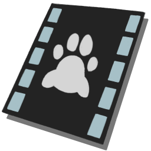
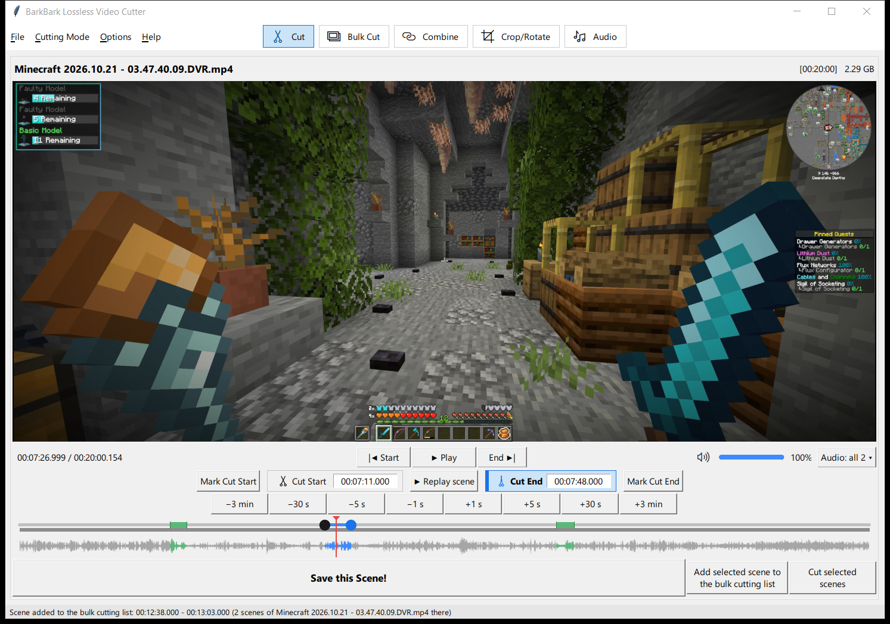
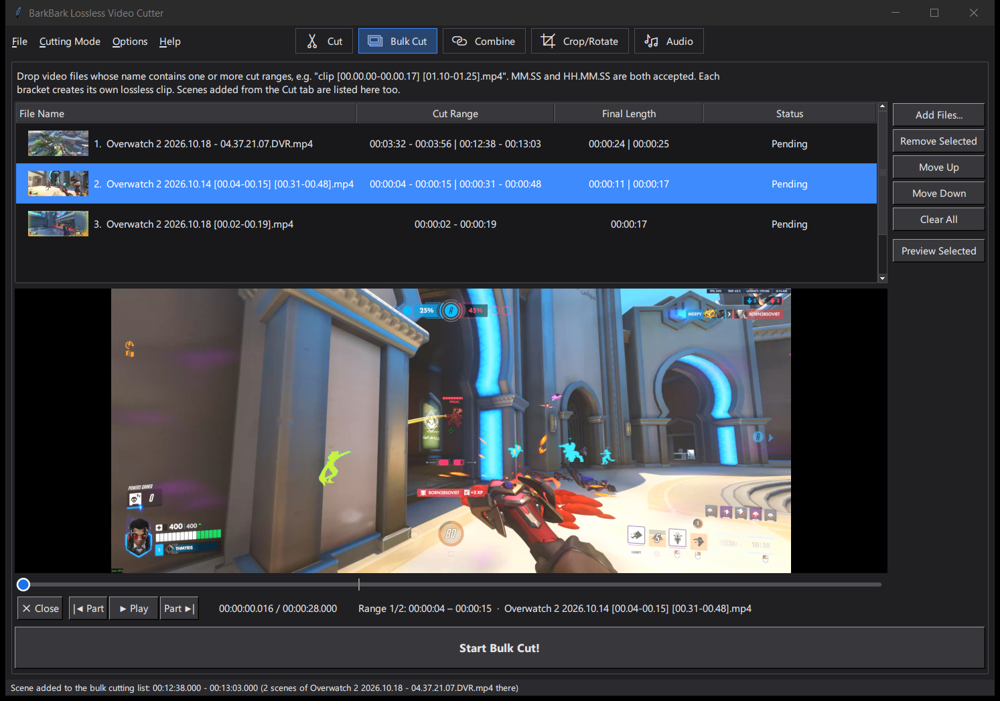
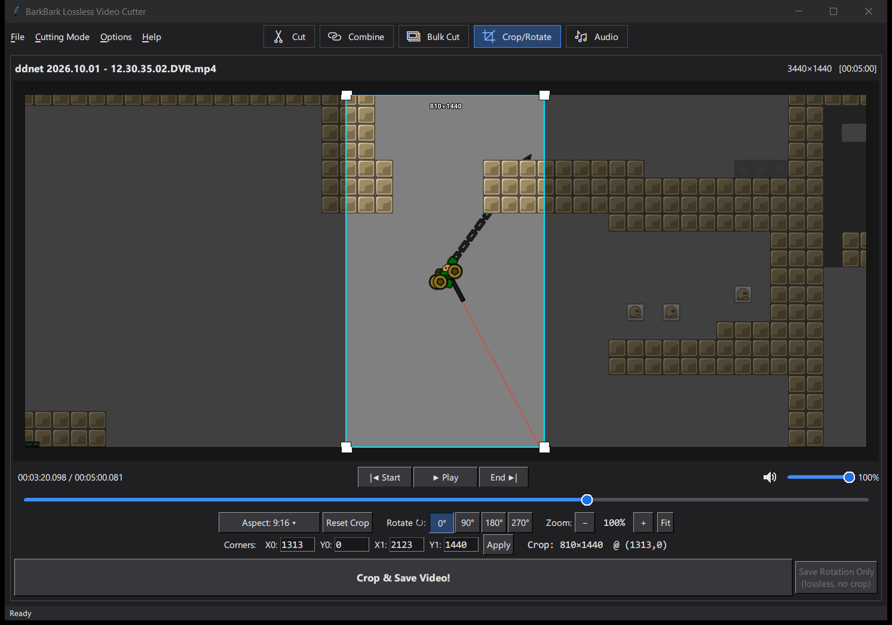
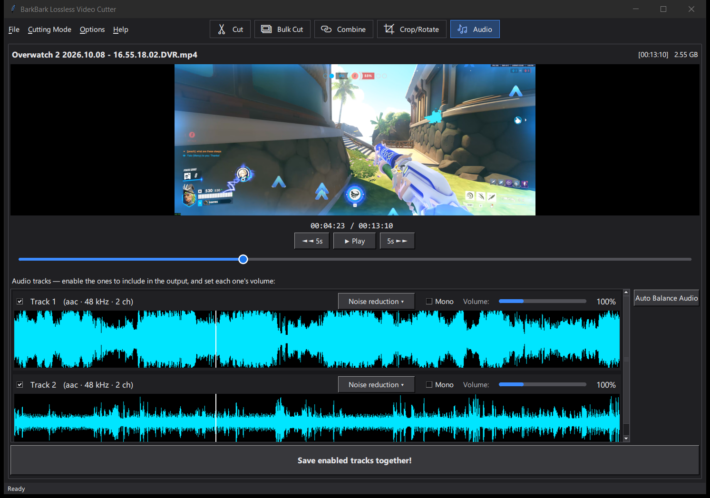

<div align="center">

<h1> BarkBark Lossless Video Cutter</h1>

The fastest and the most stable video editor for your simple video editing needs. Built with ffmpeg and mpv.
For Windows 10 / 11, and Linux ([beta](#linux-beta)).

[](https://github.com/Thmyris/BBVideoCutter/releases/latest)
[](https://github.com/Thmyris/BBVideoCutter/releases/latest)
[](#linux-beta)
[](https://github.com/Thmyris/BBVideoCutter/stargazers)
[](LICENSE)



</div>

## Features

**Cut:** Losslessly cut any video down to the millisecond easily. Cuts are <u>instant</u>, the only bottleneck is the disk write speed.

**Bulk Cut:** Batch cut hundreds of files with one click.

**Combine:** Join the cut videos together losslessly.

**Crop/Rotate:** Self explanatory.

**Audio:** Mix multiple tracks together while auto-balancing the dB levels with one click. Mute, adjust volume of a voice track. Has a simple noise cancellation filter with 3 strength levels.

<table>
  <tr>
    <td align="center" width="50%"><br><b>Bulk Cut</b></td>
    <td align="center" width="50%"><br><b>Crop/Rotate</b></td>
  </tr>
  <tr>
    <td align="center" colspan="2"><br><b>Audio</b></td>
  </tr>
</table>

## Download

Go to the [latest release](https://github.com/Thmyris/BBVideoCutter/releases/latest) page.

## Running from source

```
pip install pillow tkinterdnd2 python-mpv certifi
python BBVideoCutter.py
```

Requires ffmpeg + ffprobe on `PATH`. On Windows, double-click `run.pyw`
to start it without a console window.

The player also needs `libmpv-2.dll` (from an mpv "dev" build for Windows
x86_64, e.g. shinchiro's `mpv-dev-x86_64-*.7z`) next to
`BBVideoCutter.py`, in `release/build/`, or on `PATH`. Without it the app
shows still frames instead (on the Audio tab with the mix played by
ffplay).

Medium / Extreme noise reduction needs `deep-filter.exe` (DeepFilterNet's
`deep-filter-*-x86_64-pc-windows-msvc.exe` from its GitHub releases,
renamed) in the same places; without it those two are greyed out. Light
uses the RNNoise model in `assets/rnnoise/` (`cb.rnnn`, from
GregorR/rnnoise-models).

### Linux (beta)

Linux support is new and has only been tested on Ubuntu 24.04 under X11.
Expect rough edges, and please report them in the
[issues](https://github.com/Thmyris/BBVideoCutter/issues). On
Debian/Ubuntu:

```
sudo apt install ffmpeg libmpv2 python3-tk python3-venv
python3 -m venv ~/bbvc-venv
~/bbvc-venv/bin/pip install pillow tkinterdnd2 python-mpv certifi
~/bbvc-venv/bin/python BBVideoCutter.py
```

The player uses the system's libmpv (the `libmpv2` package). Medium /
Extreme noise reduction needs DeepFilterNet's
`deep-filter-*-x86_64-unknown-linux-musl` from its GitHub releases, renamed
to `deep-filter`, made executable, and put next to `BBVideoCutter.py` or on
`PATH`.

## Building it yourself

Scripts in `release/build/` (PyInstaller onedir + optional Inno Setup
installer):

- `build_exe.bat` — quick test build
- `build_setup.bat` — installer → `release/BBVideoCutter-Setup.exe`
- `build_portable.bat` — zip → `release/BBVideoCutter-Portable.zip`
- `build_portable_and_setup.bat` — both of the above, one after the
  other, from a single app build

Drop `ffmpeg.exe`/`ffprobe.exe`, `libmpv-2.dll` and `deep-filter.exe`
into `release/build/` first to bundle them. The RNNoise model is always
bundled.

Linux: `sh release/build/build_linux.sh` (run on Linux; needs
`python3-tk python3-venv`) → `release/BBVideoCutter-Linux-x86_64.tar.gz`.
A Linux `deep-filter` (and `ffmpeg`/`ffprobe`) in `release/build/` gets
bundled; libmpv is always the system's. Then `sh release/build/build_deb.sh`
packs that build as `release/BBVideoCutter-Linux-amd64.deb` (needs
`dpkg-deb`; its dependencies are read from the system it runs on).

## License

[MIT](LICENSE).
